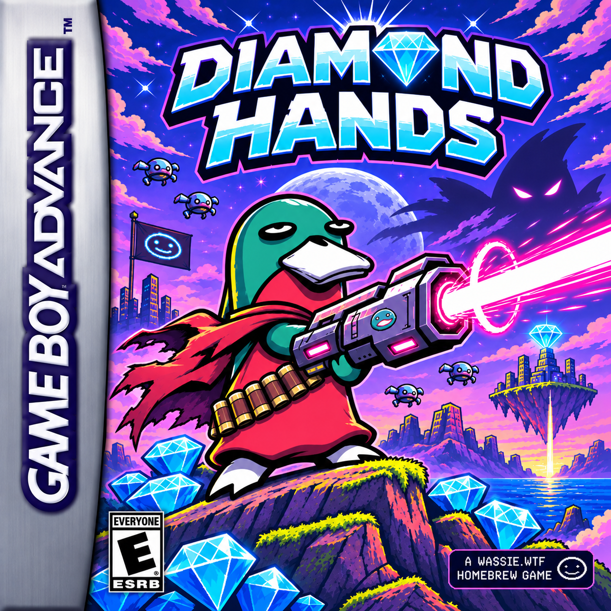

# Diamond Hands




A side-scrolling action platformer for the Game Boy Advance, written in Rust with [agb](https://agbrs.dev).
In a dystopian future the bears have built machines. A wassie in a red poncho, hauling an
oversized laser cannon, blasts its way left to right through their cyber bots. Each level ends
with a boss.

1. **The Badlands** (playable): mossy cliffs below a ruined city, from a violet dusk to a burning
   night. Sentry walkers, Crawler spider-bots, Drones and rolling Mines, then **BERA 3000**, a
   bear-shaped war mech.
2. **Solana Trenches** (playable): not a battlefield but Crypto Twitter's memecoin casino,
   where a coin launches every minute and most of them rug. CL207 calls as it starts: he is
   building a **Plasma Shield** and needs the three plasma cells hidden in the level. A neon
   Vegas strip under a giant gold coin leads into the casino floor (felt tables to hop, slot
   banks, roulette, trading screens, croupier bots dealing cards, rolling chips, a false wall
   hiding a secret tunnel), then an elevator up to the red-lit exchange suites (server racks,
   the vault, armoured guard bots). The boss is **SAM**, a cyborg exchange founder with a
   cucumber. The casino pays in **gold coins**, which the penguin cashier changes into
   diamonds after the fight.
3. **Ethereum City** (unlocked by clearing the Trenches, not built yet): where CL207's
   Plasma Shield arrives.

| Button      | Action                                                          |
| ----------- | --------------------------------------------------------------- |
| D-pad       | Move and aim: Up, Up+forward; in the air also Down, Down+forward |
| A           | Jump (hold for higher); keep holding to hover on the jetpack    |
| B           | Fire; hold and release for a charged beam                       |
| L or R      | Hold to plant your feet, so the d-pad only aims                 |
| Start       | Leaves the splash; opens and closes the pause menu; skips dialogue |

- **Splash:** the game boots to the cover art. After 1.5 s "PRESS START TO PLAY" blinks in,
  and Start (or A) opens the save files.
- **Save files:** there are three. An empty file goes straight to the title. A file with a run in
  it asks CONTINUE or NEW GAME. A new game leaves the old run in place until the new one saves,
  so a wrong pick loses nothing. Lighting a beacon saves the run, and so does clearing a level.
  CONTINUE (on the title, B goes back to the files) starts at the last beacon with full health;
  the diamonds and bots behind it stay collected or beaten. Between levels, CONTINUE opens the
  world map on the next level instead. Each file also keeps which levels it has cleared. Saves
  from before that was added are read and carried over: a run that had reached level N has
  the levels before it cleared.
- **Combat:** you can stomp bots by landing on them. A "!" over a bot means it is about to
  attack. The blaster fires in eight directions; diagonal shots fly at the same speed.
- **Jetpack:** after a jump's rise, keeping A held lights a jetpack that climbs slowly for
  48 frames. This reaches about 62 px, against 38 px for a plain jump, so the diamonds on
  the floating rocks are reachable. Letting go saves the rest of the fuel, landing or
  stomping a bot refuels it, and a quick tap in the air never hovers (it stays a buffered
  jump).
- **Arrival:** starting the Badlands fresh plays its arrival on CryptoTerra. A cargo ship drops the
  wassie off, rekt and owning nothing but its scarf. CL207, a white cat in a yellow cat-eared hazmat suit,
  explains the rules, then hands over the blaster and the jetpack. A reads the lines and Start
  skips the scene. Continuing a saved run never replays it.
- **Boss dialogue:** when the arena closes and the camera settles, the boss and the wassie
  trade a few lines. A finishes a line and then turns the page; Start skips the rest. It
  plays once per visit, so retries go straight to the fight.
- **Level clear:** the screen fades down, a ring of diamonds bursts off the wassie, the tally
  counts up row by row, and the place the clear unlocked is announced. A (after a second)
  or a 7-second wait opens the world map.
- **World map:** the hub between levels, and MAP on the title opens it too. Levels unlock in
  order: the Badlands is open on a new file, and clearing a level opens the next. Each place
  shows how far the file has got there: a diamond with a teal tick (cleared), a glinting
  diamond (open, with a "!" when newly unlocked), a padlock (locked: the line under it says
  which level to clear), or a steel "?" beacon (Ethereum City, coming soon). After a clear
  the wassie walks the road to the newly unlocked place. Left and Right move, A plays an
  open or cleared place, B goes back to the title. A cleared level can be replayed; replays
  bank no score and can't set a best. Every run saves to the file, at beacons and on clears.
- **Pause menu:** Start in a level opens it and the level waits; Start (or B) closes it and
  play carries on exactly where it stopped. Left/Right (or L/R) switch tabs:
  - CONTROLS lists every button with what it does in play and in menus. The rows come from
    the game's own input mapping (`logic/src/controls.rs`), so they can't drift from it.
  - BAG shows the wassie's gear: the blaster, the jetpack and the red scarf, each with an
    icon, its slot and an "E" when equipped. Up/Down pick an item and the box below
    describes it; A opens a card with a big icon, more detail and, for the jetpack, a live
    fuel gauge. B closes the card.
  - WALLET shows the diamond balance (banked plus this level's), the banked count, the
    level's diamonds found out of its total, gold coins (this level's and the purse), and
    the score.

  Buttons still held when the menu closes are ignored until let go, so the B that closes it
  doesn't fire and a charge held into the menu is dropped.
- **Two currencies:** diamonds are banked into the file's wallet when a level is cleared;
  the HUD shows the level's count. The Trenches pay **gold coins** instead: pickups, a
  bounty for each bot (1-3 coins) and SAM's stash (10). After SAM, the penguin cashier
  offers **1 coin = 8 diamonds**: the counter shows the coins, the rate and the diamonds
  they buy. EXCHANGE pays the wallet; KEEP MY COINS puts them in the file's purse, offered
  again at the next visit. The deal is struck once and saved with the level's clear.
  Replays bank no diamonds or coins, as they bank no score, but the purse can still be
  changed.
- **Plasma cells:** three in the Trenches, each found once per file (the bag shows how
  many); they stay found on replays.
- **Elevator:** the casino floor ends at a sealed wall. Press Up at the terminal to power
  the elevator, wait for its doors, step in and press Up again. A "^" bubble shows where Up
  does something.
- **SAM:** opens with his **Cucumber Hit** (crackling aura, then a lunge and a giant
  cucumber along the floor that knocks you flying: jump it; afterwards he's winded and takes
  double damage), lobs arcing cucumbers, and calls a **Market Crash** (the screens go red,
  candles rain, magenta energy flies). At half health his implants overload: faster, three
  cucumbers a volley, and the Cucumber Hit ends in shockwaves.
- **Health and respawns:** you have 8 HP. Touching a beacon makes it your respawn point, and
  retries are unlimited.
- **Diamonds:** they are scattered along the route, and the upper ledges hold the most.
- **Options:** sets the difficulty (Chill, Normal, Degen), which scales the damage you take and
  how often bots fire. It is saved to SRAM with the best score.

Art direction follows `cover.png` and the project skill in `.claude/skills/diamond-hands-gba/`.
The wassie's poses and effects follow the player sprite sheet there (`sprite-sheet.png`):
- the wassie has a gold rim light, a broad bill and a red neck scarf
- it squashes on a hard landing and leans back when it skids
- it runs in a six-step cycle, pitched forward and bobbing, one foot reaching ahead while
  the other kicks up behind, with the cannon carried along
- it sees stars when hit. Knocked out in the air, it tumbles down to the floor first; the
  knockout count only starts once it lands, where it slumps, falls flat and lets go of the
  cannon
- the cannon is a chunky gunmetal piece on its own palette: a glowing power cell, a carry
  handle with a cyan sight, the diamond insignia, magenta vents, a finned barrel and a big
  muzzle ring with a white-hot core
- dust puffs behind its heels when it runs, sprays ahead when it skids, and kicks up both
  ways on take-off and landing
- wind streaks show over a hard fall
- a forward shot throws a ring of light at the muzzle, and the laser bolt has a ringed head

## Layout

- `logic/`: all game rules. Tile physics, the player, villains, the boss, scenes, levels and the
  test probe. `no_std` and integer-only, tested on the host.
  - Levels are ASCII maps in `logic/src/levels/`. The legend is in `logic/src/level.rs`,
    including the scenery pictures (`DECOR`: slots, screens, signs) drawn over a block
    of their letter. Each
    level also carries its boss dialogue; places on the world map and the unlock rules are in
    `logic/src/levels.rs`.
  - The pause menu's state is in `logic/src/game.rs`; what it lists comes from
    `logic/src/controls.rs` (button bindings) and `logic/src/inventory.rs` (the bag's items).
    A new item needs an entry there and an icon in `game/src/art/menu.rs`.
- `game/`: the agb ROM. It reads buttons, steps `logic`, draws, and saves to SRAM.
  - All art is drawn in code, in `game/src/art/` (`casino.rs` and `trenches.rs` for the
    Trenches, after `.claude/skills/diamond-hands-gba/sprite-sheet-SBF.png` and
    `level2-casino-mockup.png`), except the splash, the wassie's portrait and SAM. The splash
    is `cover.png` cropped and fitted to 16 palettes by `scripts/make-splash.py` (needs
    Pillow), which writes the tiles, palettes and a preview to `game/gfx/`. SAM's poses and
    portrait are cut from the SBF sprite sheet at gameplay size by `scripts/make-sam.py`
    (review them in `game/gfx/sam.png`); only his current pose sits in sprite VRAM. Rerun a
    script when its source changes; the ROM includes those files as they are.
  - Music is tracker modules in `game/music/*.xm`, played by agb-tracker on the mixer
    (`game/src/music.rs` picks the cue from the scene); the blaster effects stay on the DMG
    channels (`game/src/sound.rs`). The songs are written in code by
    `game/music/src/soundtrack.py` with synthesized instruments: run
    `python3 game/music/src/soundtrack.py` after changing it. Cues: title, Badlands, boss,
    level clear, knocked out. The Trenches still play the Badlands' theme.
  - It builds with its own nightly toolchain and target (`game/rust-toolchain.toml`,
    `game/.cargo/config.toml`), so it is excluded from the workspace.
- `harness/`: headless ROM tests on the [gba-wasm](https://github.com/smolgroot/gba-wasm) core,
  which must be checked out next to this repo.

## Build and run

Install agb-gbafix once:

```sh
cargo install agb-gbafix
```

Then:

```sh
./scripts/build-rom.sh            # → dist/diamond-hands.gba
./scripts/build-rom.sh --dev      # → dist/diamond-hands-dev.gba: every level open on the map
(cd game && cargo run --release)  # play in mgba-qt
```

The dev ROM (`DEV` in the title screen's corner) opens every level on the world map from
a new file, so the Trenches can be played without beating the Badlands. It changes only
what the map lets you start: nothing extra is saved, and a level beaten there counts as a
first clear.

To play in gba-wasm, load `dist/diamond-hands.gba` in its browser UI (`pnpm dev` in `../gba-wasm`).

## Test

```sh
cargo test -p diamond_hands_logic    # rules, boss phases, map checks, route-bot clears
cargo test -p diamond_hands_harness  # boots the ROM on gba-wasm (needs dist/diamond-hands.gba)
```

The logic tests also check every map for authoring mistakes: unreachable steps, spawns inside
rock, the arena size, and diamonds on floating rock that the jetpack can't reach. They also
check that the dialogue fits the box and the font. A route bot then plays each level in god
mode and must beat the boss.

Each frame, the ROM mirrors a `Probe` struct into EWRAM. The harness finds it by its `DHPR` magic, then checks:
- scene flow
- running, jumping, firing
- pausing
- SRAM persistence
- hovering, and diagonal and downward aim
- the world map: locked and coming-soon places, and unlocking the Trenches by clearing the
  Badlands, which survives a power cycle
- the pause menu's tabs, items and inspect card, and that closing it neither fires nor
  moves the level on
- that the ROM matches the host-side model frame by frame while the route bot clears the
  Badlands, including the boss dialogue

Set `DIAMOND_HANDS_SHOTS=<dir>` to have the harness save screenshots (PPM) of the title, map,
hovering, aiming, each line of dialogue, the level-clear sequence, each pause-menu page and
every area of the Trenches, SAM's attacks and the exchange (`t2-*`).

## Known limitations

- Two levels are playable; Ethereum City shows on the map once unlocked but can't be
  played yet. The Trenches have no music of their own yet.
- Sprite VRAM is full. Each level's own sprites load while it is on screen (`LevelArt` in
  `game/src/render.rs`): BERA 3000 and the arrival ship in the Badlands, the casino's in the
  Trenches. Even alone the casino's don't fit, so they come in two halves swapped as the
  camera goes: the floors' (bots, elevator, terminal) and the arena's (SAM, the penguin).
- The world map is painted each time it opens (about half a second) and dropped when it
  closes: its tiles don't fit in background VRAM beside a level's. Moving between the
  Badlands and the Trenches repaints the backdrop over three frames for the same reason.
- `World` keeps its actor table on the heap, and `Game` its `World`: built on the IWRAM
  stack they overflowed it at boot.
- Saves from before the casino (version 5) are moved over with an empty wallet: version 5
  kept no diamond balance. A run saved part-way through the old Trenches starts the
  rebuilt level from the top.
- Background VRAM is nearly full too. All eight screenblocks are taken, so the pause menu
  borrows the dialogue box's unused rows, and while it is open the dialogue text lends it
  its tiles. The menu is drawn on an 8x8 grid so each glyph is one shared tile, and a page
  needs about 170-230 tiles. Switching tabs takes about a tenth of a second, and the new
  page wipes in over a few frames.

If a harness test fails, try the ROM in mGBA. If it behaves correctly there, the bug is in gba-wasm:
1. Record it in gba-wasm as a failing test or a `TASKS.md` entry.
2. Mark the harness test `#[ignore = "gba-wasm: …"]`.

## Website

The showcase site is a [VitePress](https://vitepress.dev) project in `site/` (custom theme matching wassie.wtf:
its MUI palette and Londrina Solid). `cd site && npm ci && npm run dev` to preview it; pushes to `master`
deploy it to GitHub Pages. Set `SITE_BASE=/` to build for a root domain.
